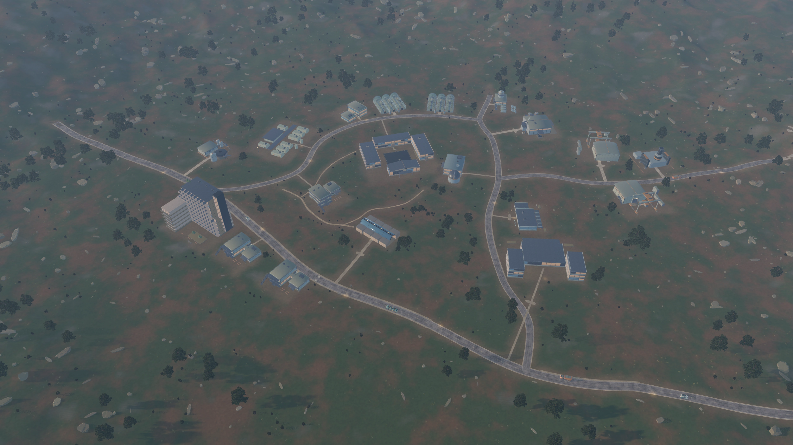
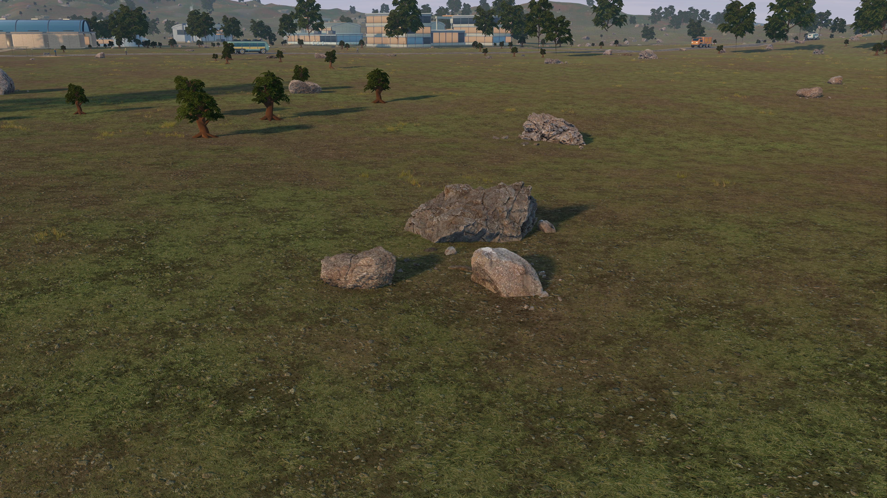
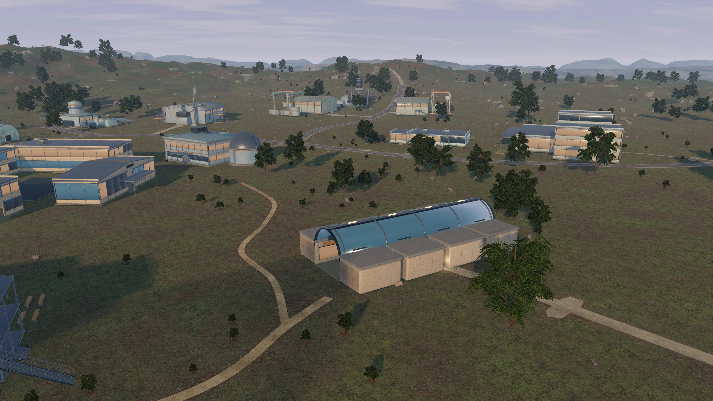
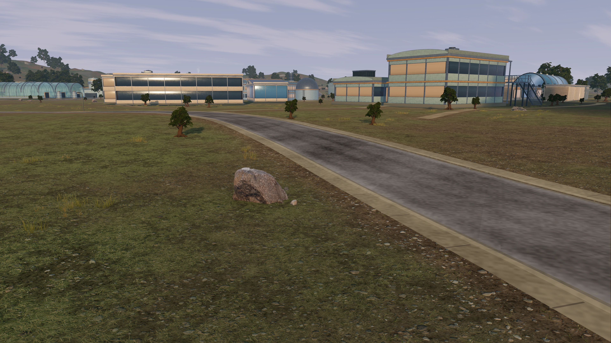

# Approved terrain and settlement art

The owner approved three pieces together: the CC-GEO-2.3 random world generator with mountain and plateau snow, the physical settlement layout in revision 06, and the road verges, soil and weathered rocks in revision 07. Use this package to integrate these decisions into **Colony Charter** and ship a playable Windows version.

The handoff branch starts at `v17-charter` commit `96d26551623c6b7c84a9db4143ce38956c11f6a4`. Its `game/project.godot` declares **1.11.1**. At preparation time, the default `main` branch declared 1.10.1. All additions in this delivery live under this handoff directory. The production integration and release belong to the next step.

## Start here

| File or folder | What to use |
| --- | --- |
| [Instructions for Claude](CLAUDE_INSTRUCTIONS.md) | The owner's implementation request and release checks, ready to paste into a Claude Code session. |
| [Map generator and integration steps](map/MAP.md) | Runtime changes for the approved geography and snow. Apply to a compatible production game and run the supplied checks. |
| [Region project and reproduction commands](region/README.md) | A standalone Godot project for the approved local scene, complete with the building, vehicle, road and material inputs. |
| [Layout measurements](reference/approved-layout.json) | Metric building sizes and locations, planning window, road widths and measured spacing for the representative inland settlement. |
| [Visual references](reference/) | Godot reference frames and the reviewed world samples. The WebP files retain the original image dimensions. |
| [File integrity check](verify_package.py) | Run `python verify_package.py` in the handoff directory after retrieving Git LFS objects. |

## Reproduction results

The map patches applied to a clean 1.11.1 game reproduced the approved eight satellite PNGs byte for byte. The map-only Windows export exercised a new expedition, both map views and legacy save loading. The regional project separately reproduced all three approved 4K frames from both source and an isolated export pack on the reference GPU. The combined production game is the release deliverable described in the instructions. [Map validation](map/validation.json) · [Regional validation](region/REFERENCE_CHECK.json)

## Visual targets

| Settlement layout | Ground and rocks |
| --- | --- |
|  |  |
|  |  |

[Eight approved world samples](reference/world-eight-seeds.webp) · [Mountain and plateau snow detail](reference/world-snow-detail.webp)

The regional reference was reviewed at dusk in Godot 4.5.1 Forward+. The release game also supports GL Compatibility. Match the reference at the normal game cameras and take comparison frames from the packaged game in its supported renderers.
