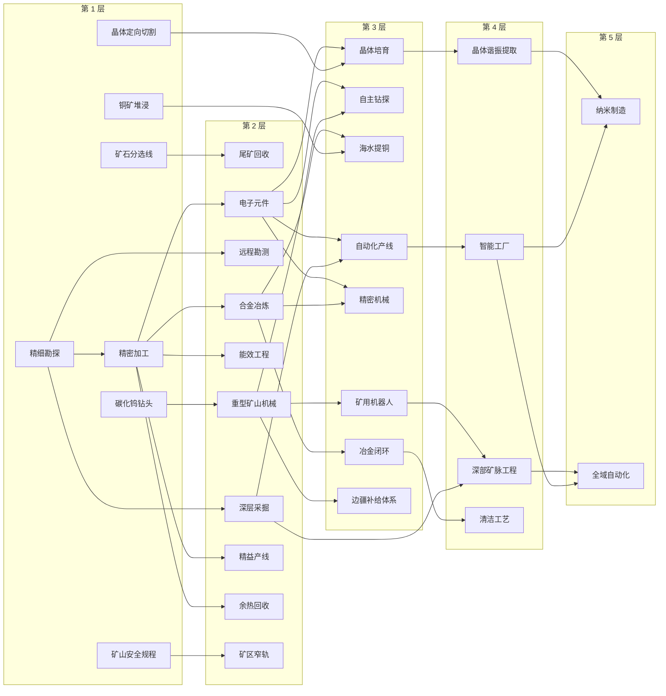
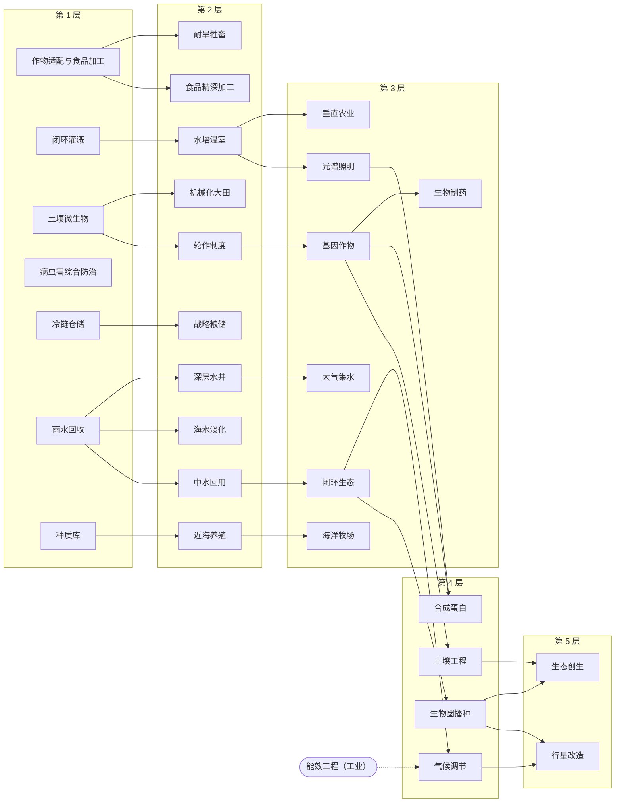
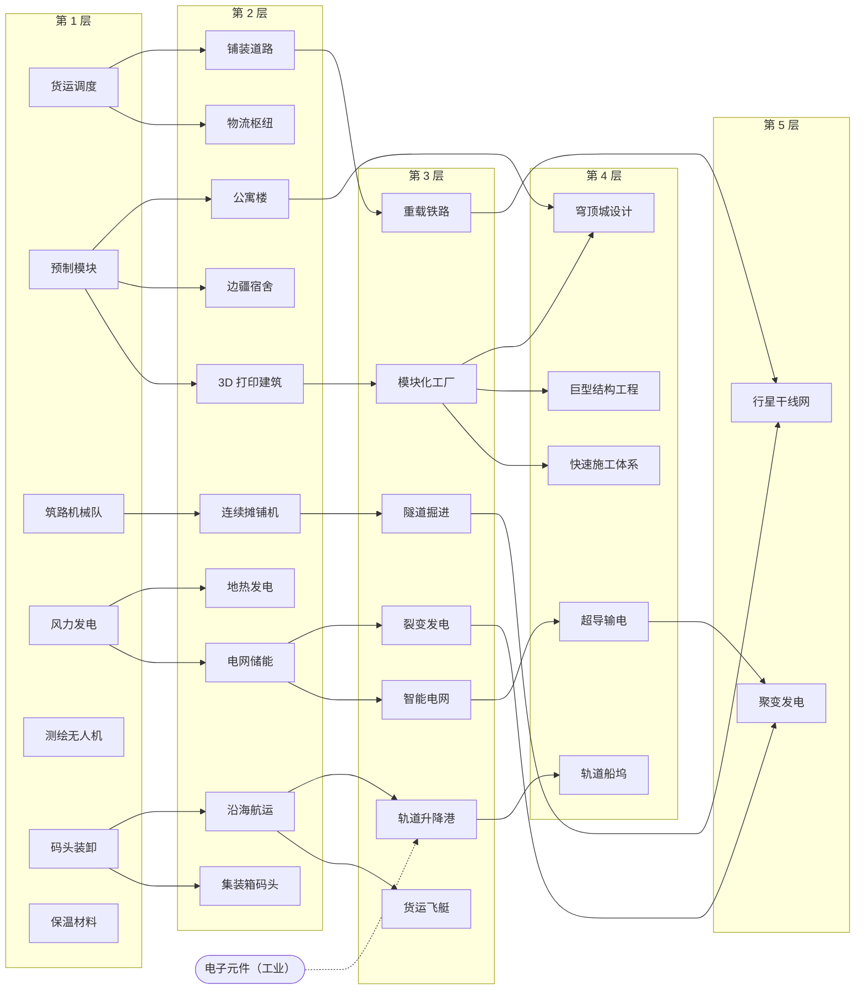
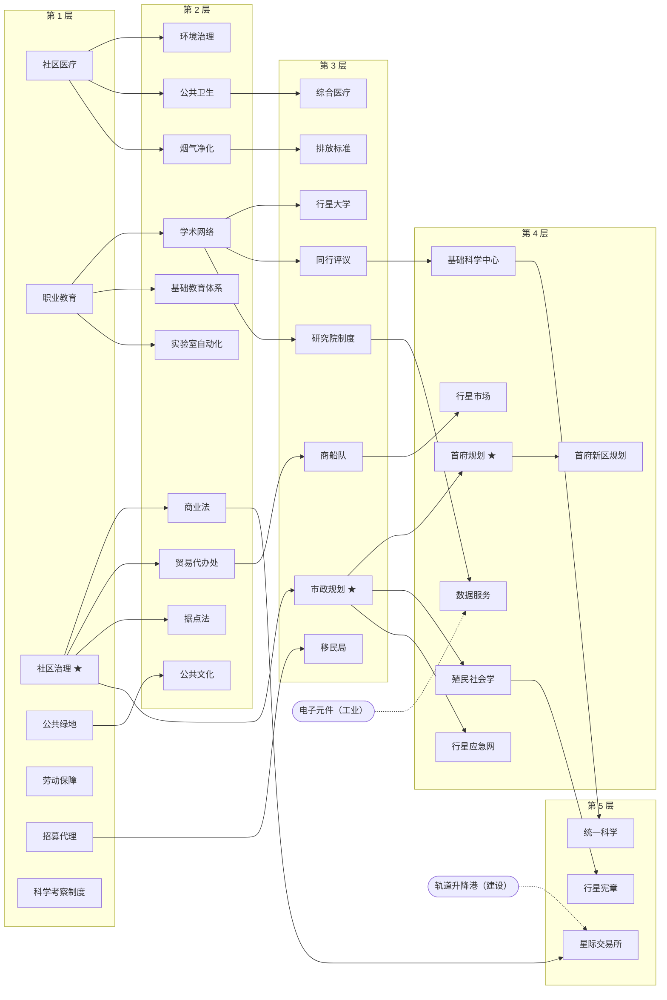

# 殖民契约 1.9 · Technology tree

Generated by `tools/tech_tree.py` from `game/data/v17/techs.json` (and the facilities,
upgrades, link levels and events that name a technology). Do not edit by hand: change the
data and run the script again.

## How research works

- 127 technologies in four directions, each in tiers 1–5, plus 3 gift technologies that only events hand over.
- Each direction deals 3 cards at a time from what its prerequisites allow (weighted by `weight`); a team works one direction at a time. Finishing a card deals that direction again. Some technologies add cards.
- Re-dealing a direction costs ¥600 + ¥300 × the highest tier researched.
- ★ marks what the charter cannot be finished without: it is dealt as soon as it can be started.
- Research points per day follow the team size: R(n) = R10 × (n / 10)^0.737 (five teams give 60% of ten).
- First cards: 工业「精细勘探」、农业「作物适配与食品加工」、建设「货运调度」、社会「职业教育」.

## Size of the tree

| 方向 | 第 1 层 | 第 2 层 | 第 3 层 | 第 4 层 | 第 5 层 | 合计 |
|---|---|---|---|---|---|---|
| 工业 | 7 | 10 | 8 | 4 | 2 | 31 |
| 农业 | 7 | 10 | 7 | 4 | 2 | 30 |
| 建设 | 7 | 10 | 7 | 5 | 2 | 31 |
| 社会 | 7 | 10 | 8 | 7 | 3 | 35 |

Prerequisites that cross directions: 气候调节 ← 能效工程、轨道升降港 ← 电子元件、数据服务 ← 电子元件、星际交易所 ← 轨道升降港.

## 工业（`industry`）· 矿山、工厂和冶炼

| 层 | 技术 | 研究量 | 前置 | 效果 | 解锁 |
|---|---|---|---|---|---|
| 1 | **晶体定向切割** `crystal_cutting` | 160 | — | 晶体日产 +15%。 | — |
| 1 | **矿山安全规程** `mine_safety` | 160 | — | 矿山维护费 -10%，吸引力 +0.02。 | — |
| 1 | **矿石分选线** `ore_sorting` | 160 | — | 铁矿日产 +15%：废石在出坑前就被挑出去了。 | — |
| 1 | **碳化钨钻头** `drill_bits` | 160 | — | 矿山日产 +10%。钻头寿命翻倍，换班不再等配件。 | — |
| 1 | **精密加工** `processing` | 160 | 精细勘探 | 加工厂产量 +30%。 | — |
| 1 | **精细勘探** `survey` | 160 | — | 矿山日产 +20%；揭示已勘察地点的真实矿量与品位。 | — |
| 1 | **铜矿堆浸** `copper_leach` | 160 | — | 铜矿日产 +15%。 | — |
| 2 | **余热回收** `smelter_heat` | 340 | 精密加工 | 工厂用电和污染都少一点：用电 -8%，排放 -8%。 | — |
| 2 | **合金冶炼** `alloy_smelting` | 340 | 精密加工 | 解锁合金冶炼厂：铁和铜变成更值钱的合金。 | 设施「合金冶炼厂」 |
| 2 | **尾矿回收** `tailings_recovery` | 340 | 矿石分选线 | 解锁尾矿回收站：不消耗矿床，从旧矿渣里再榨一遍。 | 设施「尾矿回收站」 |
| 2 | **深层采掘** `deep_mining` | 340 | 精细勘探 | 解锁矿场二级升级（产量 +60%，岗位 +4）和深层矿床。 | 「轻型铁矿场」升到 2 级；「轻型铜矿场」升到 2 级；「晶体采掘站」升到 2 级 |
| 2 | **电子元件** `electronics` | 340 | 精密加工 | 解锁电子元件厂和加工厂二级升级。 | 设施「电子元件厂」；「复合加工厂」升到 2 级 |
| 2 | **矿区窄轨** `ore_trains` | 340 | 矿山安全规程 | 矿山日产 +10%，矿山维护费再 -10%。 | — |
| 2 | **精益产线** `lean_line` | 340 | 精密加工 | 所有工厂产量 +15%。 | — |
| 2 | **能效工程** `efficiency` | 340 | 精密加工 | 用电 -25%，维护费 -20%。 | — |
| 2 | **远程勘测** `prospecting` | 340 | 精细勘探 | 勘察费用减半；揭示一定范围内的隐藏矿床。 | — |
| 2 | **重型矿山机械** `heavy_machinery` | 340 | 碳化钨钻头 | 解锁边疆据点的重型矿场和矿井。 | 设施「重型铁矿场」；设施「重型铜矿场」；设施「重型晶体矿井」 |
| 3 | **冶金闭环** `metal_cycle` | 620 | 合金冶炼 | 合金产量 +20%，排放 -15%。 | — |
| 3 | **晶体培育** `crystal_growth` | 620 | 晶体定向切割、电子元件 | 解锁晶体培育槽：工业晶体不再只能靠挖。 | 设施「晶体培育槽」 |
| 3 | **海水提铜** `seawater_extraction` | 620 | 铜矿堆浸、合金冶炼 | 解锁海水提铜站：沿海的边疆据点不靠矿床也能产铜。 | 设施「海水提铜站」 |
| 3 | **矿用机器人** `mine_robots` | 620 | 重型矿山机械 | 矿场岗位 -15%，矿山日产 +10%。 | — |
| 3 | **精密机械** `precision_machinery` | 620 | 合金冶炼、电子元件 | 解锁精密机械厂：合金和元件变成最贵的出口货。 | 设施「精密机械厂」 |
| 3 | **自主钻探** `auto_drilling` | 620 | 重型矿山机械、电子元件 | 解锁边疆据点的自动钻场：只要几支工程队看守。 | 设施「自动铁矿钻场」；设施「自动铜矿钻场」；设施「自动晶体钻场」 |
| 3 | **自动化产线** `automation` | 620 | 深层采掘、电子元件 | 矿场和工厂岗位 -30%；解锁矿场三级升级。 | 「轻型铁矿场」升到 3 级；「轻型铜矿场」升到 3 级；「晶体采掘站」升到 3 级 |
| 3 | **边疆补给体系** `frontier_logistics` | 620 | 重型矿山机械 | 边疆据点产量 +10%。 | — |
| 4 | **晶体谐振提取** `crystal_resonance` | 1000 | 晶体培育 | 晶体日产 +40%。 | — |
| 4 | **智能工厂** `smart_factory` | 1000 | 自动化产线 | 工厂岗位 -25%，工厂产量 +20%。 | — |
| 4 | **深部矿脉工程** `deep_core` | 1000 | 深层采掘、矿用机器人 | 矿山日产 +25%。 | — |
| 4 | **清洁工艺** `clean_process` | 1000 | 冶金闭环 | 排放 -25%。 | — |
| 5 | **全域自动化** `total_automation` | 1600 | 智能工厂、深部矿脉工程 | 矿场和工厂岗位再 -20%。 | — |
| 5 | **纳米制造** `nano_fabrication` | 1600 | 智能工厂、晶体谐振提取 | 所有工厂产量再 +30%。 | — |

## 农业（`agriculture`）· 粮食、水和生态

| 层 | 技术 | 研究量 | 前置 | 效果 | 解锁 |
|---|---|---|---|---|---|
| 1 | **作物适配与食品加工** `adaptation` | 160 | — | 可在寒冷和干旱地点耕作；解锁食品出口加工坊。 | 设施「食品出口加工坊」 |
| 1 | **冷链仓储** `cold_chain` | 160 | — | 每人每天少浪费一点：食品消耗 -5%。 | — |
| 1 | **土壤微生物** `soil_microbes` | 160 | — | 农场产量 +10%：这颗星球的土第一次有了菌群。 | — |
| 1 | **病虫害综合防治** `pest_control` | 160 | — | 农场产量 +8%。 | — |
| 1 | **种质库** `seed_bank` | 160 | — | 农场产量 +5%，吸引力 +0.02。 | — |
| 1 | **闭环灌溉** `irrigation` | 160 | — | 农场用水 -30%，产量 +20%。 | — |
| 1 | **雨水回收** `rain_capture` | 160 | — | 供水 +10%。 | — |
| 2 | **中水回用** `water_recycling` | 340 | 雨水回收 | 用水 -15%。 | — |
| 2 | **战略粮储** `grain_reserve` | 340 | 冷链仓储 | 食品消耗再 -5%，吸引力 +0.03。 | — |
| 2 | **机械化大田** `mechanized_farming` | 340 | 土壤微生物 | 解锁边疆据点的大田农业站。 | 设施「大田农业站」 |
| 2 | **水培温室** `hydroponics` | 340 | 闭环灌溉 | 解锁水培温室：产量不受土壤影响，但耗电很高。 | 设施「水培温室」；「温室农场」升到 2 级 |
| 2 | **海水淡化** `desalination_tech` | 340 | 雨水回收 | 解锁海水淡化厂。 | 设施「海水淡化厂」 |
| 2 | **深层水井** `deep_wells` | 340 | 雨水回收 | 解锁深层水井：地表没水的地方也能打出水来。 | 设施「深层水井」 |
| 2 | **耐旱牲畜** `livestock` | 340 | 作物适配与食品加工 | 解锁边疆据点的牧场：贫瘠的地也能产粮。 | 设施「牧场」 |
| 2 | **轮作制度** `crop_rotation` | 340 | 土壤微生物 | 农场产量 +12%。 | — |
| 2 | **近海养殖** `aquaculture` | 340 | 种质库 | 解锁沿海边疆据点的近海养殖场。 | 设施「近海养殖场」 |
| 2 | **食品精深加工** `food_export` | 340 | 作物适配与食品加工 | 食品加工坊收入 +25%。 | — |
| 3 | **光谱照明** `indoor_lighting` | 620 | 水培温室 | 室内农业产量 +30%。 | — |
| 3 | **垂直农业** `vertical_farming` | 620 | 水培温室 | 解锁居住据点的垂直农场。 | 设施「垂直农场」 |
| 3 | **基因作物** `genetic_crops` | 620 | 轮作制度 | 农场产量 +25%。 | — |
| 3 | **大气集水** `atmospheric_harvest` | 620 | 深层水井 | 解锁大气集水站：干旱地点不再被水卡住。 | 设施「大气集水站」 |
| 3 | **海洋牧场** `marine_ranching` | 620 | 近海养殖 | 室内和近海农业产量 +20%。 | — |
| 3 | **生物制药** `biopharma` | 620 | 基因作物 | 解锁居住据点的生物制药厂：粮食变成药品。 | 设施「生物制药厂」 |
| 3 | **闭环生态** `closed_ecology` | 620 | 中水回用 | 用水 -20%，星球吸收污染能力 +30%。 | — |
| 4 | **合成蛋白** `synthetic_protein` | 1000 | 基因作物、光谱照明 | 解锁居住据点的合成蛋白厂。 | 设施「合成蛋白厂」 |
| 4 | **土壤工程** `soil_engineering` | 1000 | 基因作物 | 农场产量 +30%。 | — |
| 4 | **气候调节** `climate` | 1000 | 闭环生态、能效工程 | 解锁巨型工程：气候调节站。 | 巨型工程「气候调节站」 |
| 4 | **生物圈播种** `biosphere_seeding` | 1000 | 闭环生态 | 星球吸收污染能力 +50%。 | — |
| 5 | **生态创生** `ecopoiesis` | 1600 | 生物圈播种、土壤工程 | 农场产量 +30%，星球吸收污染能力再 +100%。 | — |
| 5 | **行星改造** `terraforming` | 1600 | 气候调节、生物圈播种 | 解锁巨型工程行星改造计划：三期工程让全星球更温和、更湿润、更肥沃。 | 巨型工程「行星改造计划」；「行星改造计划」升到 2 级；「行星改造计划」升到 3 级 |

## 建设（`construction`）· 住房、电力、道路和港口

| 层 | 技术 | 研究量 | 前置 | 效果 | 解锁 |
|---|---|---|---|---|---|
| 1 | **保温材料** `insulation` | 160 | — | 用电 -5%，建设费用 -3%。 | — |
| 1 | **测绘无人机** `survey_drones` | 160 | — | 路线投资 -10%，勘察费用 -20%。 | — |
| 1 | **码头装卸** `cargo_handling` | 160 | — | 港口吞吐 +15%。 | — |
| 1 | **筑路机械队** `road_crews` | 160 | — | 修路速度 +20%。 | — |
| 1 | **货运调度** `logistics` | 160 | — | 道路运力 +40%，运费 -20%。 | 「轨道货运站」升到 2 级 |
| 1 | **预制模块** `prefab_modules` | 160 | — | 建设速度 +10%。 | — |
| 1 | **风力发电** `wind_power` | 160 | — | 解锁风电场。 | 设施「风电场」 |
| 2 | **3D 打印建筑** `printed_buildings` | 340 | 预制模块 | 建设速度 +15%，建设费用 -5%。 | — |
| 2 | **公寓楼** `apartments` | 340 | 预制模块 | 解锁居住据点的公寓楼。 | 设施「公寓楼」 |
| 2 | **地热发电** `geothermal_power` | 340 | 风力发电 | 解锁地热电站。 | 设施「地热电站」 |
| 2 | **沿海航运** `shipping` | 340 | 码头装卸 | 航线运力 +50%，航速 +20%；解锁码头扩建「大型货运码头」。 | 线路升级「大型货运码头 ×2」 |
| 2 | **物流枢纽** `freight_yards` | 340 | 货运调度 | 解锁区域物流中心。 | 设施「区域物流中心」 |
| 2 | **电网储能** `grid_storage` | 340 | 风力发电 | 发电 +15%。 | — |
| 2 | **边疆宿舍** `frontier_lodges` | 340 | 预制模块 | 解锁边疆据点的宿舍楼。 | 设施「边疆宿舍楼」 |
| 2 | **连续摊铺机** `road_machines` | 340 | 筑路机械队 | 修路速度 +30%，路线投资 -10%；解锁道路升级「四车道干线」（铺装之后）。 | 线路升级「四车道干线」 |
| 2 | **铺装道路** `paved_roads` | 340 | 货运调度 | 解锁道路升级「铺装路面」：运力 +50%，单程 -1 天，封路风险 -70%。 | 线路升级「铺装路面」 |
| 2 | **集装箱码头** `container_ports` | 340 | 码头装卸 | 港口吞吐 +25%。 | — |
| 3 | **智能电网** `smart_grid` | 620 | 电网储能 | 用电 -15%。 | — |
| 3 | **模块化工厂** `modular_fabs` | 620 | 3D 打印建筑 | 建设费用 -10%，建设速度 +10%。 | — |
| 3 | **裂变发电** `fission_power` | 620 | 电网储能 | 解锁裂变电站。 | 设施「裂变电站」 |
| 3 | **货运飞艇** `cargo_airships` | 620 | 沿海航运 | 航速 +30%，航线运力 +30%。 | — |
| 3 | **轨道升降港** `lift_port` | 620 | 沿海航运、电子元件 | 解锁巨型工程：轨道升降港。 | 巨型工程「轨道升降港」 |
| 3 | **重载铁路** `heavy_rail` | 620 | 铺装道路 | 陆路运力 +30%，单程时间 -20%。 | — |
| 3 | **隧道掘进** `tunnel_boring` | 620 | 连续摊铺机 | 修路速度 +30%，封路风险更低。 | — |
| 4 | **巨型结构工程** `megastructures` | 1000 | 模块化工厂 | 巨型工程工期 -25%，费用 -15%。 | — |
| 4 | **快速施工体系** `rapid_construction` | 1000 | 模块化工厂 | 建设速度再 +25%。 | — |
| 4 | **穹顶城设计** `arcology_design` | 1000 | 公寓楼、模块化工厂 | 解锁居住据点的生态穹顶城。 | 设施「生态穹顶城」 |
| 4 | **超导输电** `superconductors` | 1000 | 智能电网 | 发电再 +25%。 | — |
| 4 | **轨道船坞** `orbital_shipyard` | 1000 | 轨道升降港 | 解锁巨型工程轨道船坞：远征和海运更便宜，船更快。 | 巨型工程「轨道船坞」 |
| 5 | **聚变发电** `fusion_power` | 1600 | 裂变发电、超导输电 | 解锁聚变电站。 | 设施「聚变电站」 |
| 5 | **行星干线网** `planetary_transit` | 1600 | 重载铁路、隧道掘进 | 陆路运力和单程时间再改善 30%。 | — |

## 社会（`society`）· 医疗、教育、治理和贸易

| 层 | 技术 | 研究量 | 前置 | 效果 | 解锁 |
|---|---|---|---|---|---|
| 1 | **公共绿地** `green_spaces` | 160 | — | 解锁生态公园。 | 设施「生态公园」 |
| 1 | **劳动保障** `labour_law` | 160 | — | 吸引力 +0.05，离开更少。 | — |
| 1 | **招募代理** `recruit_agency` | 160 | — | 招募价格 -20%，自发移民 +10%。 | — |
| 1 | **社区医疗** `medicine` | 160 | — | 解锁诊所（吸引力 +0.3，离开减半，出生 ×1.5）和住区二级升级。 | 设施「社区诊所」；「模块住区」升到 2 级 |
| 1 | **社区治理** ★ `community_admin` | 160 | — | 行政费 -15%。 | — |
| 1 | **科学考察制度** `field_notes` | 160 | — | 科研速度 +5%。 | — |
| 1 | **职业教育** `education` | 160 | — | 培训速度 ×2；开放研究团队招募。 | 招募研究团队 |
| 2 | **公共卫生** `public_health` | 340 | 社区医疗 | 出生 +30%，吸引力 +0.05。 | — |
| 2 | **公共文化** `civic_culture` | 340 | 公共绿地 | 解锁文化中心。 | 设施「文化中心」 |
| 2 | **商业法** `commerce_law` | 340 | 社区治理 | 解锁商业街区：居民的钱终于有地方花了。 | 设施「商业街区」 |
| 2 | **基础教育体系** `school_system` | 340 | 职业教育 | 解锁中等学校。 | 设施「中等学校」 |
| 2 | **学术网络** `research_network` | 340 | 职业教育 | 解锁研究所二级（20 席、3 项目）和科研委托。 | 「教学研究所」升到 2 级；科研委托 |
| 2 | **实验室自动化** `lab_automation` | 340 | 职业教育 | 科研速度 +10%，每个类别多一张候选课题。 | — |
| 2 | **据点法** `settlement_law` | 340 | 社区治理 | 远征费用 -25%。 | — |
| 2 | **烟气净化** `scrubbing` | 340 | 社区医疗 | 解锁污染净化塔。 | 设施「污染净化塔」 |
| 2 | **环境治理** `remediation` | 340 | 社区医疗 | 星球吸收污染能力 +50%，治理费用 -50%。 | — |
| 2 | **贸易代办处** `trade_office` | 340 | 社区治理 | 出口市场更深：价格下跌更慢 +30%。 | — |
| 3 | **同行评议** `scientific_method` | 620 | 学术网络 | 科研速度 +15%。 | — |
| 3 | **商船队** `trade_fleet` | 620 | 贸易代办处 | 出口价格 +5%，市场更深 +30%。 | — |
| 3 | **市政规划** ★ `civic_planning` | 620 | 社区治理 | 解锁市政中心。 | 设施「市政中心」 |
| 3 | **排放标准** `emission_standards` | 620 | 烟气净化 | 排放 -20%。 | — |
| 3 | **研究院制度** `research_institutes` | 620 | 学术网络 | 解锁研究院：20 席、3 个实验台。 | 设施「研究院」 |
| 3 | **移民局** `immigration_office` | 620 | 招募代理 | 自发移民 +20%。 | — |
| 3 | **综合医疗** `hospital_care` | 620 | 公共卫生 | 解锁综合医院。 | 设施「综合医院」 |
| 3 | **行星大学** `university` | 620 | 学术网络 | 解锁巨型工程：行星大学。 | 巨型工程「行星大学」 |
| 4 | **基础科学中心** `deep_research` | 1000 | 同行评议 | 科研速度 +20%。 | — |
| 4 | **数据服务** `data_services` | 1000 | 研究院制度、电子元件 | 解锁数据中心：向星外出售算力。 | 设施「数据中心」 |
| 4 | **殖民社会学** `sociology` | 1000 | 市政规划 | 吸引力 +0.1，离开更少。 | — |
| 4 | **行星市场** `planetary_market` | 1000 | 商船队 | 出口价格再 +5%，市场更深 +40%。 | — |
| 4 | **行星应急网** `emergency_network` | 1000 | 市政规划 | 解锁巨型工程行星应急网：事件损失和道路封闭减少。 | 巨型工程「行星应急网」 |
| 4 | **首府新区规划** `capital_district` | 1000 | 首府规划 | 解锁巨型工程首府新区：建在首府，最多 5 级，每级加床位、吸引力并减少行政开支。 | 巨型工程「首府新区」；「首府新区」升到 2 级；「首府新区」升到 3 级；「首府新区」升到 4 级；「首府新区」升到 5 级 |
| 4 | **首府规划** ★ `capital_planning` | 1000 | 市政规划 | 解锁巨型工程：行星议会大厦。总督资格的最后一块拼图。 | 巨型工程「行星议会大厦」 |
| 5 | **星际交易所** `offworld_exchange` | 1600 | 轨道升降港、商业法 | 解锁巨型工程星际交易所：所有出口市场的容量 +50%。 | 巨型工程「星际交易所」 |
| 5 | **统一科学** `unified_science` | 1600 | 基础科学中心 | 科研速度再 +30%。 | — |
| 5 | **行星宪章** `charter_of_rights` | 1600 | 殖民社会学 | 吸引力 +0.15，自发移民 +20%。 | — |

## Gift technologies (event only)

Never dealt, never researched, not counted towards the charter's technology goals. The event that offers one opens only where it makes sense (a finished road, or a pair of cargo docks) and only while the colony lacks it.

| 技术 | 效果 | 来自事件 |
|---|---|---|
| **红球快运车队** `red_ball_express` | 事件赠予，无法研究。单行环线昼夜不停，车头漆红球、路上优先：陆路单程时间 -20%，道路运力 +10%。 | 「车头上的红球」(`red_ball_loop`) |
| **高速货轮** `fast_freighters` | 事件赠予，无法研究。两艘退役高速货轮编入航线：航速 +25%。 | 「两艘退役的快船」(`retired_freighters`) |
| **大型散货船** `bulk_freighters` | 事件赠予，无法研究。打捞修复的大型散货船跑最忙的航线：航线运力 +40%。 | 「外海搁浅的散货船」(`stranded_bulker`) |
