# 重点长事件链阅读索引

按实际可走的最长路线列出节点，结局分支数量单独统计，避免把并列节点误当成游玩长度。

| 事件 | 总节点 | 最长路线 | 结局字符串数 | 明确概率分支 |
| --- | --- | --- | --- | --- |
| 第二条水位线（water） | 9 | 7 | 11 | 有 |
| 岩层下的值班簿（archaeology） | 10 | 7 | 13 | 有 |
| 最后一班货车总是空的（nw_a_last_return） | 8 | 6 | 11 | 有 |
| 午夜多出来的一段功率（nw_a_midnight_power） | 9 | 7 | 12 | 有 |
| 桥墩上的第三次读数（crack） | 10 | 8 | 14 | 有 |
| 被白纸遮住的山脊（blank_ridge） | 9 | 9 | 14 | 有 |
| 前哨空着的那一间房（nw_b_shared_room） | 9 | 9 | 11 | 有 |
| 净水滤网里的黑色年轮（nw_b_tidal_archive） | 9 | 8 | 14 | 有 |
| 仍在向空处发信（silent_probe） | 10 | 7 | 14 | 有 |
| 首府二字写在什么地方（capital_debate） | 8 | 8 | 12 | 有 |
| 水表只记得流过多少水（nw_c_public_meter） | 9 | 8 | 13 | 有 |
| 感谢您多年来使用本产品（nw_c_end_of_support） | 9 | 8 | 15 | 有 |
| 钻孔深处有一片星空（nw_e_buried_sky） | 10 | 9 | 17 | 有 |
| 山谷在凌晨向海移动（nw_e_valley_migration） | 10 | 8 | 18 | 有 |

## 第二条水位线

代表路线：第二条水位线 → 古河道不在地图上 → 井已经建好，地图仍未画完 → 被借走的夜间水 → 两种验收，一次雨季 → 没有掌声的那条曲线 → 第一杯水留在桌上

可达结局：「保守取水」、「分流方案搁置」、「分流试验归档」、「含盐扩张」、「扩建资料留存」、「水线封存」、「精测验收」、「试运延期」、「调蓄验收」、「配水协议」、「隔离试运中止」

节点全文、选项与数值见《01_事件文案总册》。

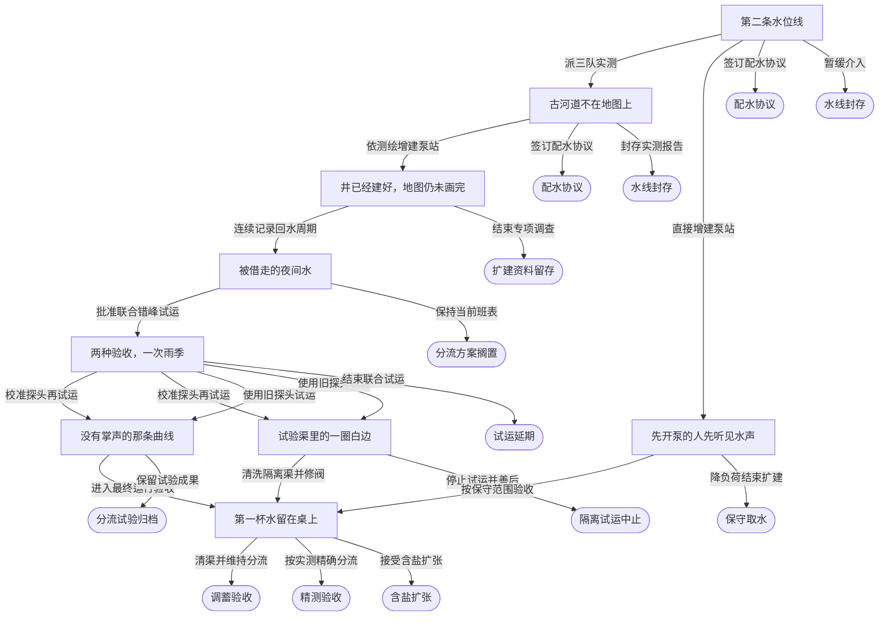

## 岩层下的值班簿

代表路线：岩层下的值班簿 → 没有人签收的下一班 → 撤离清单上的额外座位 → 从管道里传来的声音 → 那层白色不是盐 → 留出一条不用的筛线 → 不是高品位，而是另一种分法

可达结局：「值班簿归档」、「勘探队去向查明」、「受控资料保留」、「失效区间公开」、「工作站声音归档」、「工艺边界待证」、「快速试车撤回」、「撤离名册修复」、「样本保管」、「样本完成」、「试验负证据留存」、「调查权转让」、「遗址封存」

节点全文、选项与数值见《01_事件文案总册》。

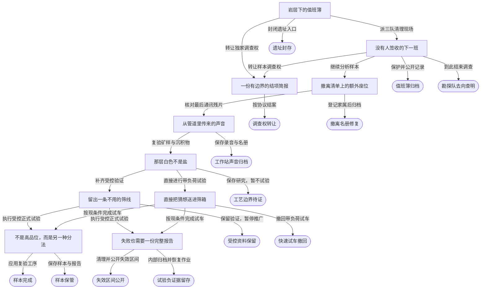

## 最后一班货车总是空的

代表路线：最后一班货车总是空的 → 货物在四扇门前等候 → 港口与公路的两只钟 → 一辆没有货物的试车 → 返程车上终于有了货 → 给空出来的时间定价

可达结局：「交接问题已记录」、「快速改表撤回」、「接口演练归档」、「旧班表继续」、「港路共同班表」、「港路轮转中止」、「班表研究封存」、「联合窗口暂缓」、「联合试运归档」、「赶得上的晚饭」、「轻量交接规程」

节点全文、选项与数值见《01_事件文案总册》。

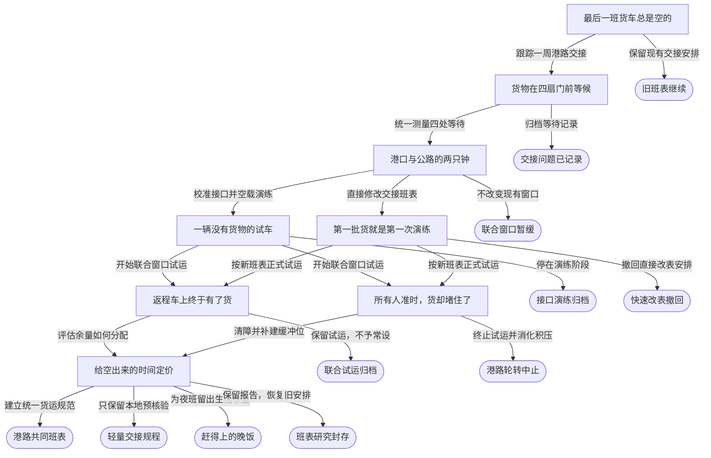

## 午夜多出来的一段功率

代表路线：午夜多出来的一段功率 → 一段不属于管道的节拍 → 行星在缓慢地呼吸 → 岩芯记住了尚未到来的时刻 → 在地层的节拍之外等候 → 一个很小的用途，一块更大的空白 → 留给下一次轻叩的预算

可达结局：「午夜曲线暂存」、「地层热潮记录」、「热潮控制中止」、「热潮数据公用」、「热潮档案封存」、「热潮观测公开」、「热潮运行规程」、「热潮验证归档」、「直接试调撤回」、「行星热潮研究」、「计量偏差已排除」、「隔离研究暂存」

节点全文、选项与数值见《01_事件文案总册》。

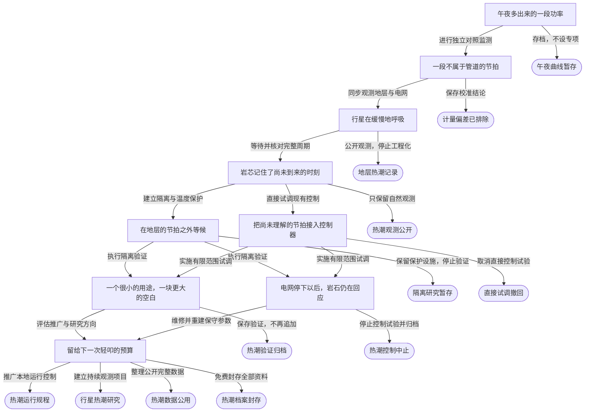

## 桥墩上的第三次读数

代表路线：桥墩上的第三次读数 → 同一条缝的两种曲线 → 岩芯里没有干燥的一层 → 新钢材到达旧桥下面 → 最后一辆压载车上桥前 → 一只传感器先报了错 → 压载车缓慢驶过 → 复测表上多出的一行

可达结局：「便桥通车」、「修复通行」、「停运半月」、「全线复检」、「封桥候修」、「封桥待筹」、「待验封闭」、「旧桥封存」、「桥档留存」、「桥检成规」、「紧急修复」、「维修中止」、「虚惊一场」、「返工搁置」

节点全文、选项与数值见《01_事件文案总册》。

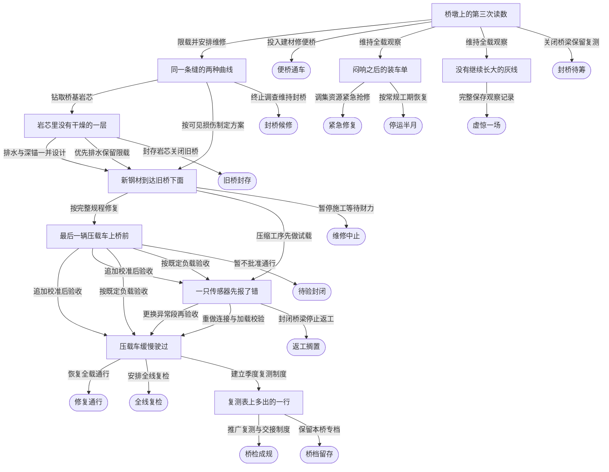

## 被白纸遮住的山脊

代表路线：被白纸遮住的山脊 → 磁针在旧营地转了半圈 → 在干岩里听见的水 → 旧工作票上的最后一班 → 矿线和水线画在同一张图上 → 清水瓶旁的第一段岩芯 → 水样里出现的细闪光 → 白纸下的未完工记录 → 没有被覆盖的新地图

可达结局：「冒险深采」、「山脊复静」、「山脊待查」、「新图入档」、「旧营封存」、「旧账出清」、「水脉留白」、「白图封存」、「知止留图」、「矿水共记」、「矿脉探明」、「让渡开发权」、「试孔封存」、「高价出让」

节点全文、选项与数值见《01_事件文案总册》。

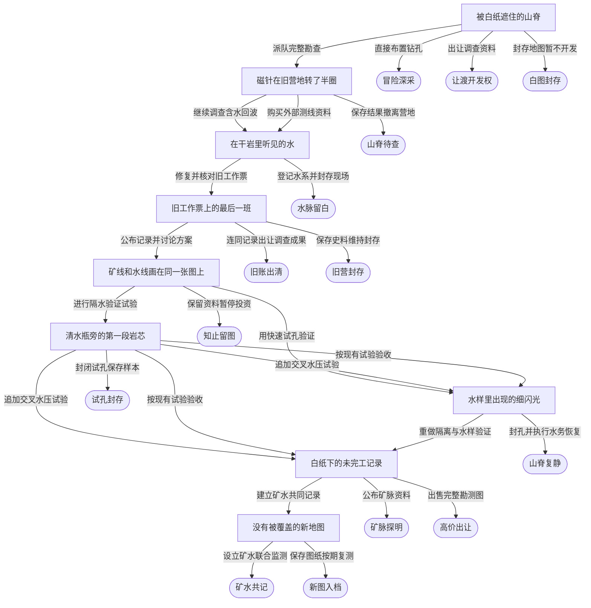

## 前哨空着的那一间房

代表路线：前哨空着的那一间房 → 检查单上的第三种用途 → 日程表没有共同的白天 → 第一次开放前的椅子 → 放映中断的那十分钟 → 轮到没有发言的人 → 门牌上终于写了名字 → 热闹过去以后仍亮着的灯 → 共同生活也有交接表

可达结局：「一季共用」、「公共间启用」、「共同生活约定」、「共用暂停」、「共用暂缓」、「开门延期」、「开门试验终止」、「空屋上锁」、「空屋归仓」、「空屋避险」、「限期共用约定」

节点全文、选项与数值见《01_事件文案总册》。

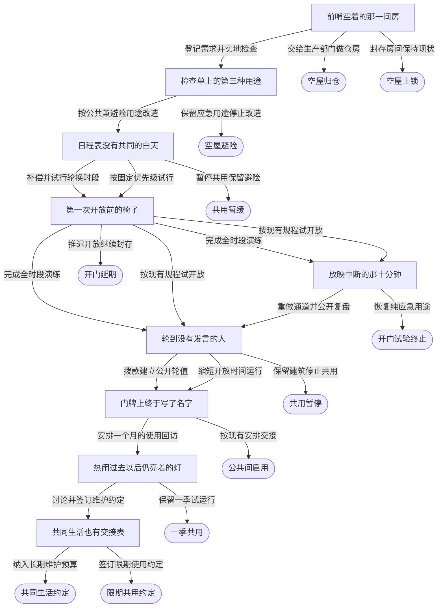

## 净水滤网里的黑色年轮

代表路线：净水滤网里的黑色年轮 → 三个取样瓶有不同的日期 → 那些没有被叫作事故的日子 → 同一片海岸的两张收入表 → 试验池边没有庆功的人 → 一项有效但有限的结果 → 说明书上的停用条件 → 下一季潮水来过以后

可达结局：「一季清流」、「海岸留息」、「海膜封卷」、「海膜归档」、「海膜论文」、「潮水备忘」、「潮水有档」、「潮间待议」、「试区封存」、「黑膜封控」、「黑膜待查」、「黑膜清除」、「黑膜留样」、「黑膜资料授权」

节点全文、选项与数值见《01_事件文案总册》。

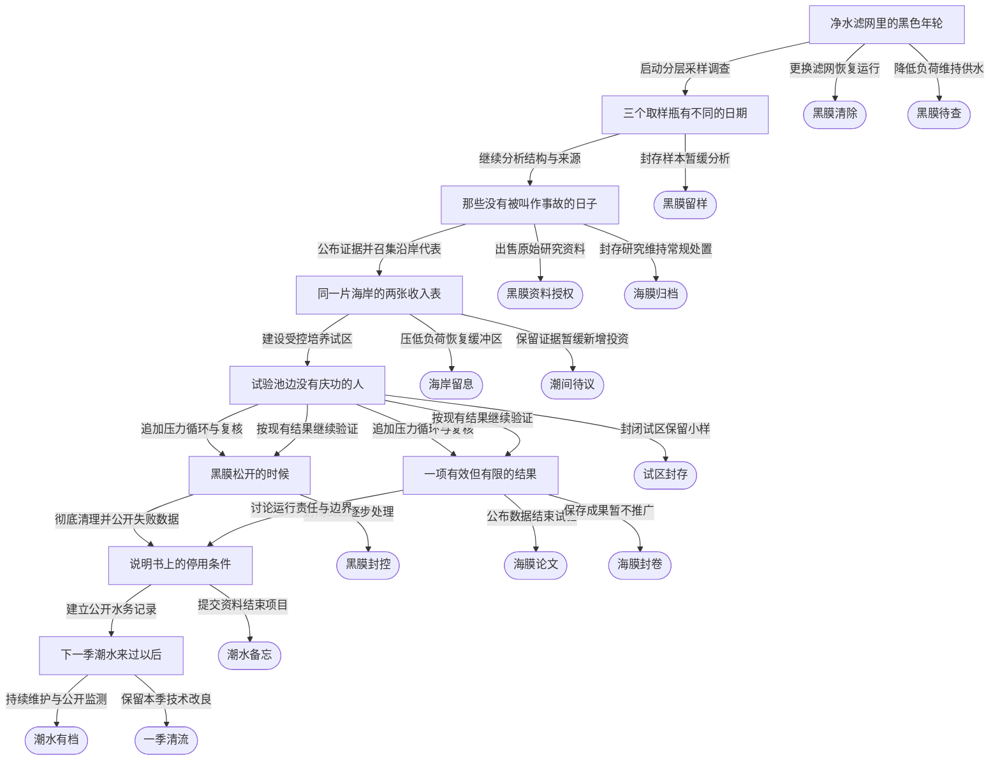

## 仍在向空处发信

代表路线：仍在向空处发信 → 接收站编号并非坐标 → 半张图上的整条虚线 → 时间从交接那天停下 → 地图没有替我们钻孔 → 一份可以公开的授权 → 比登陆简报更早的地图

可达结局：「一段短码」、「交接问题归档」、「仍在轨道上」、「内部校准资料」、「勘探谨慎止步」、「原始数据转让」、「回收后封存」、「地图公开」、「地图售出」、「失败也被记住」、「探测记录受损」、「校准档案封存」、「校准记录待应用」、「残片归档」

节点全文、选项与数值见《01_事件文案总册》。

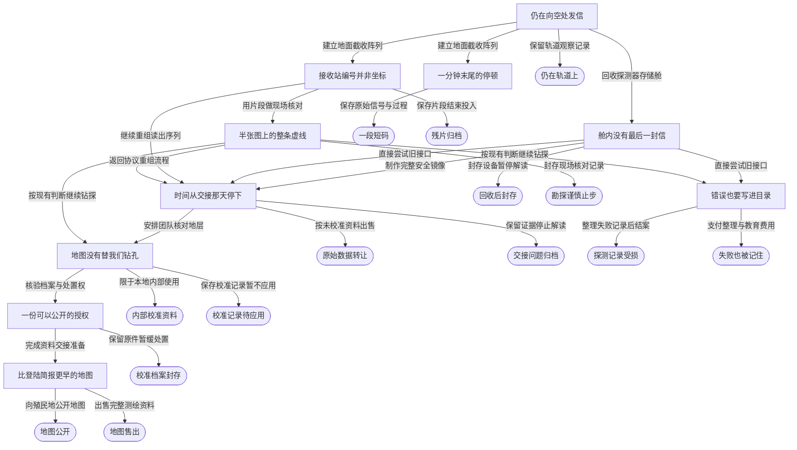

## 首府二字写在什么地方

代表路线：首府二字写在什么地方 → 三座城的等待时间 → 被统计遗漏的回程 → 同一张表有了两个版本 → 盖章的窗口全部开着 → 装不进搬迁箱的手续 → 章程中没有赢家的名字 → 一份不再需要找人的回执

可达结局：「不予回复」、「两城之路」、「两城并立」、「共同服务章程」、「分权试办失败」、「章程限期复审」、「等待记录公开」、「维持现状」、「试办暂时撤回」、「限期共同受理」、「首府交通补偿」、「首府协商搁置」

节点全文、选项与数值见《01_事件文案总册》。

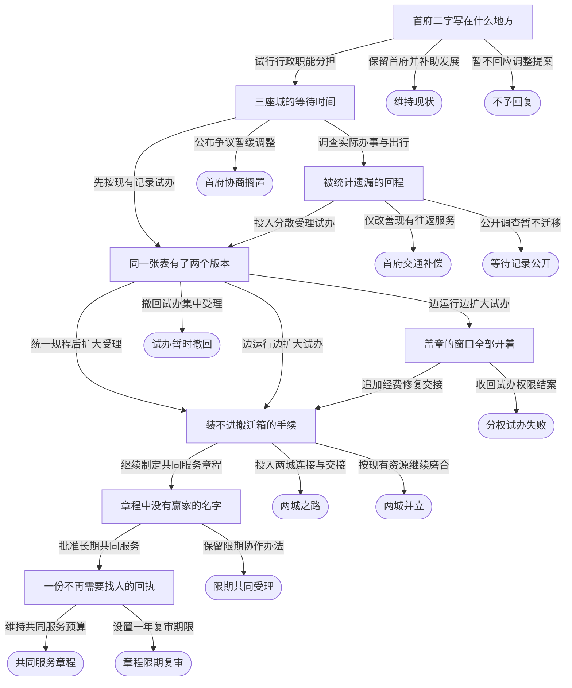

## 水表只记得流过多少水

代表路线：水表只记得流过多少水 → 每个人都报销过一小部分 → 先写清它不能做什么 → 让陌生班组照规程开机 → 交班单没有留下空栏 → 不是所有投入都能退回 → 签字之前再看一次总账 → 第一次按约定更换密封

可达结局：「公共泵正式接管」、「公共泵试验止步」、「共同投入留档」、「共同维护约定」、「共同维护续期」、「旧泵商业接管」、「旧泵复验未续」、「旧泵权属暂缓」、「旧泵短约」、「旧泵退出保障」、「旧泵限期保障」、「旧泵限用」、「维护谈判暂停」

节点全文、选项与数值见《01_事件文案总册》。

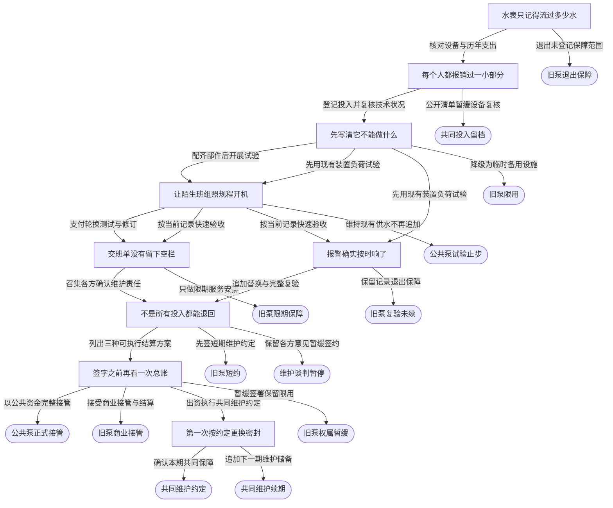

## 感谢您多年来使用本产品

代表路线：感谢您多年来使用本产品 → 一枚小芯片经过四次搬家 → 手记中撕掉的一页 → 请作者站到安全线外 → 新人也能找出那处错误 → 谁负责更新第二版 → 仓库里多了一种普通零件 → 后来的人翻开第一页

可达结局：「外部维护续接」、「支持终止照常运行」、「旧件过渡储备」、「替代标准外售」、「替代标准暂缓」、「替代验证失败」、「本地替代分期推广」、「本地标准试用」、「本地样件封存」、「标准委托推广」、「第二版由后来者写」、「维护建议待排期」、「维护知识入库」、「维护能力留在本地」、「设备依赖归档」

节点全文、选项与数值见《01_事件文案总册》。

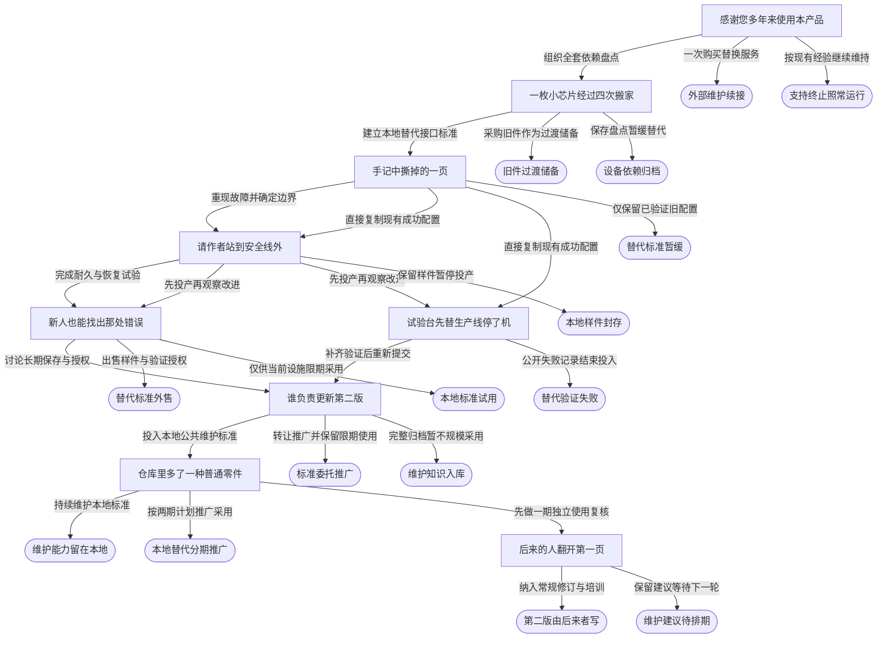

## 钻孔深处有一片星空

代表路线：钻孔深处有一片星空 → 断层没有切断那条线 → 星点从岩缝间漏出来 → 天花板在脚下展开 → 已经熄灭的恒星 → 每一盏灯都有去处 → 给陌生年代的一分钟 → 第三个光点亮起来了 → 我们的点留在图上

可达结局：「一分钟尚未发出」、「三灯入史」、「借来的星光」、「古天图初稿」、「古天图封卷」、「地下星空待访」、「星光启运」、「星光隔着岩石」、「星图有新住客」、「星图留在山里」、「星图被切开」、「星门未敲」、「未启之门」、「熄灯后的星图」、「这一夜仍很长」、「道路止于此处」、「门内无人」

节点全文、选项与数值见《01_事件文案总册》。

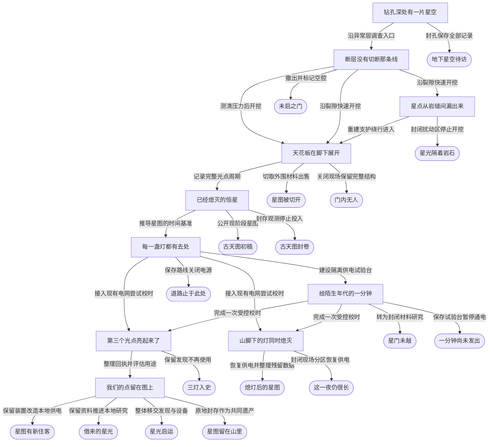

## 山谷在凌晨向海移动

代表路线：山谷在凌晨向海移动 → 田地下有一座育幼场 → 五十六年前的潮线 → 透明的帆遮住了太阳 → 风来的时候只能选一次 → 有翼的雨向天上落去 → 空壳把水留在了土里 → 给下一阵风留一条路

可达结局：「一枚翼留在瓶中」、「下一阵风有路可走」、「从一枚翼开始」、「余帆抵海」、「借住在旧育幼场」、「出发被看见」、「山谷的客人」、「山谷重新安静」、「把海岸还给风」、「无人记录的出发」、「最后一片帆的记录」、「没有起飞的帆」、「潮帆从城外经过」、「等候另一场风」、「育幼场留在界外」、「见过向上的雨」、「迁移写进了合同」、「错过风的育幼场」

节点全文、选项与数值见《01_事件文案总册》。

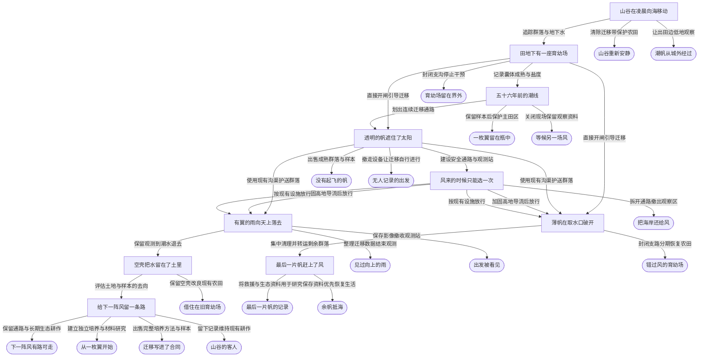

