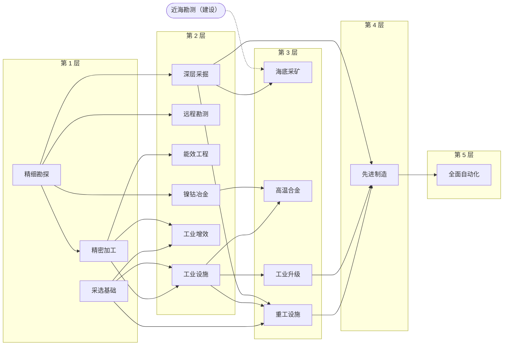
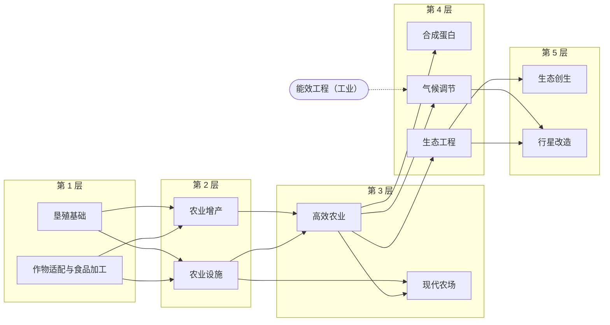
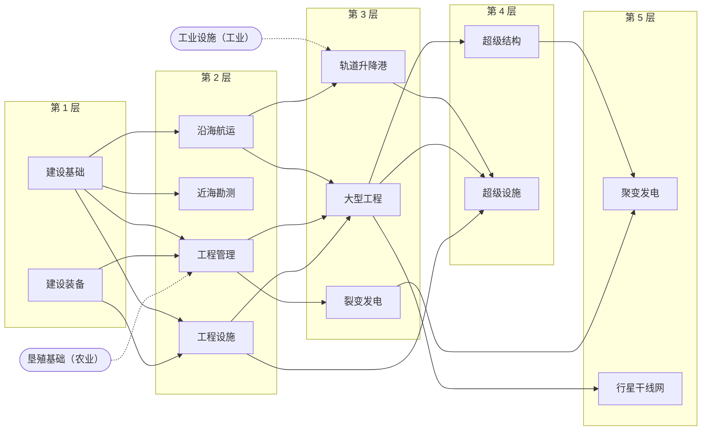
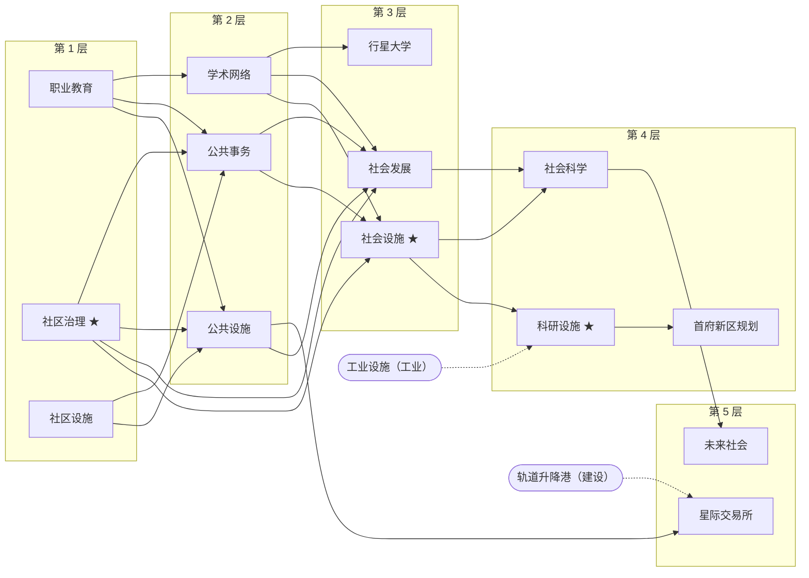

# 殖民契约 · Technology tree, 56 (a comparison, not in the game)

Generated by `tools/tech_tree.py` from `game/data/v17/techs.json` (and the facilities,
upgrades, link levels and events that name a technology). Do not edit by hand: change the
data and run the script again.

**A comparison, not in the game.** `tools/tech_merge.py --mode=unlockers` on the data before the merge (`4a4e12d`), the reading that lands in the plan's 55-65: in each direction and tier, the technologies that only add effects become one, and those that open a facility, an upgrade or a link level become another (109 into 29); the 49 facilities, upgrades and link levels that named a merged technology name its bundle. Kept as they are: the 15 technologies the game's code or other rules name (精细勘探、精密加工、深层采掘、远程勘测、能效工程、作物适配与食品加工、气候调节、沿海航运、轨道升降港、职业教育、学术网络、行星大学、行星改造、首府新区规划、近海勘测), the 3 gift technologies and the 3 frozen ones. Every effect's total is unchanged; a bundle costs its parts × 0.8. Merging every unlocker in with the bonuses instead gives 41. The tree in the game is `TECH_TREE_85.md`.

## How research works

- 53 technologies in four directions, each in tiers 1–5, plus 3 gift technologies that only events hand over.
- Each direction deals 3 cards at a time from what its prerequisites allow (weighted by `weight`); a team works one direction at a time. Finishing a card deals that direction again. Some technologies add cards.
- Re-dealing a direction costs ¥600 + ¥300 × the highest tier researched.
- ★ marks what the charter cannot be finished without: it is dealt as soon as it can be started.
- Research points per day follow the team size: R(n) = R10 × (n / 10)^0.737 (five teams give 60% of ten).
- First cards: 工业「精细勘探」、农业「作物适配与食品加工」、建设「建设装备」、社会「职业教育」.

## Size of the tree

| 方向 | 第 1 层 | 第 2 层 | 第 3 层 | 第 4 层 | 第 5 层 | 合计 |
|---|---|---|---|---|---|---|
| 工业 | 3 | 6 | 4 | 1 | 1 | 15 |
| 农业 | 2 | 2 | 2 | 3 | 2 | 11 |
| 建设 | 2 | 4 | 3 | 2 | 2 | 13 |
| 社会 | 3 | 3 | 3 | 3 | 2 | 14 |

Prerequisites that cross directions: 气候调节 ← 能效工程、轨道升降港 ← 工业设施、星际交易所 ← 轨道升降港、海底采矿 ← 近海勘测、工程管理 ← 垦殖基础、科研设施 ← 工业设施.

## 工业（`industry`）· 矿山、工厂和冶炼

| 层 | 技术 | 研究量 | 前置 | 效果 | 解锁 |
|---|---|---|---|---|---|
| 1 | **精密加工** `processing` | 160 | 精细勘探 | 加工厂产量 +30%。 | — |
| 1 | **精细勘探** `survey` | 160 | — | 矿山日产 +20%；揭示已勘察地点的真实矿量与品位。 | — |
| 1 | **采选基础** `industry_1_merged` | 640 | — | 合并了「碳化钨钻头」「矿石分选线」「铜矿堆浸」「晶体定向切割」「矿山安全规程」：矿山日产 +10%。钻头寿命翻倍，换班不再等配件。铁矿日产 +15%：废石在出坑前就被挑出去了。铜矿日产 +15%。晶体日产 +15%。矿山维护费 -10%，吸引力 +0.02。 | — |
| 2 | **工业增效** `industry_2_merged` | 816 | 精密加工、采选基础 | 合并了「精益产线」「余热回收」「矿区窄轨」：所有工厂产量 +15%。工厂用电和污染都少一点：用电 -8%，排放 -8%。矿山日产 +10%，矿山维护费再 -10%。 | — |
| 2 | **工业设施** `industry_2_unlocks` | 1088 | 采选基础、精密加工 | 合并了「尾矿回收」「重型矿山机械」「电子元件」「合金冶炼」：解锁尾矿回收站：不消耗矿床，从旧矿渣里再榨一遍。解锁边疆据点的重型矿场和矿井。解锁电子元件厂和加工厂二级升级。解锁合金冶炼厂：铁和铜变成更值钱的合金。 | 设施「重型铁矿场」；设施「重型铜矿场」；设施「重型晶体矿井」；设施「尾矿回收站」；设施「合金冶炼厂」；设施「电子元件厂」；「复合加工厂」升到 2 级 |
| 2 | **深层采掘** `deep_mining` | 340 | 精细勘探 | 解锁矿场二级升级（产量 +60%，岗位 +4）和深层矿床。 | 「轻型铁矿场」升到 2 级；「轻型铜矿场」升到 2 级；「晶体采掘站」升到 2 级 |
| 2 | **能效工程** `efficiency` | 340 | 精密加工 | 用电 -25%，维护费 -20%。 | — |
| 2 | **远程勘测** `prospecting` | 340 | 精细勘探 | 勘察费用减半；揭示一定范围内的隐藏矿床。 | — |
| 2 | **镍钴冶金** `nickel_metallurgy` | 340 | 精细勘探 | 解锁镍矿场和钴矿场：镍矿带常在铁矿带里；钴更稀少，常和镍、铜伴生，深海结核里也有。 | 设施「镍矿场」；设施「钴矿场」 |
| 3 | **工业升级** `industry_3_merged` | 1488 | 工业设施 | 合并了「冶金闭环」「矿用机器人」「边疆补给体系」：合金产量 +20%，排放 -15%。矿场岗位 -15%，矿山日产 +10%。边疆据点产量 +10%。 | — |
| 3 | **海底采矿** `seabed_mining` | 620 | 近海勘测、深层采掘 | 解锁海底采矿平台：在码头外查明的近海富矿上开采，矿石由驳船运回码头，出口或加工。 | 设施「海底采矿平台」 |
| 3 | **重工设施** `industry_3_unlocks` | 2480 | 深层采掘、工业设施、采选基础 | 合并了「自动化产线」「自主钻探」「海水提铜」「晶体培育」「精密机械」：矿场和工厂岗位 -30%；解锁矿场三级升级。解锁边疆据点的自动钻场：只要几名职工看守。解锁海水提铜站：沿海的边疆据点不靠矿床也能产铜。解锁晶体培育槽：工业晶体不再只能靠挖。解锁精密机械厂：合金和元件变成最贵的出口货。 | 设施「自动铁矿钻场」；设施「自动铜矿钻场」；设施「自动晶体钻场」；设施「海水提铜站」；设施「晶体培育槽」；设施「精密机械厂」；「轻型铁矿场」升到 3 级；「轻型铜矿场」升到 3 级；「晶体采掘站」升到 3 级 |
| 3 | **高温合金** `superalloys` | 620 | 镍钴冶金、工业设施 | 解锁高温合金厂：两份镍加半份钴炼成一份高温合金，价格是合金的三倍多。 | 设施「高温合金厂」 |
| 4 | **先进制造** `industry_4_merged` | 3200 | 深层采掘、工业升级、重工设施 | 合并了「深部矿脉工程」「晶体谐振提取」「智能工厂」「清洁工艺」：矿山日产 +25%。晶体日产 +40%。工厂岗位 -25%，工厂产量 +20%。排放 -25%。 | — |
| 5 | **全面自动化** `industry_5_merged` | 2560 | 先进制造 | 合并了「纳米制造」「全域自动化」：所有工厂产量再 +30%。矿场和工厂岗位再 -20%。 | — |

## 农业（`agriculture`）· 粮食、水和生态

| 层 | 技术 | 研究量 | 前置 | 效果 | 解锁 |
|---|---|---|---|---|---|
| 1 | **作物适配与食品加工** `adaptation` | 160 | — | 可在寒冷和干旱地点耕作；解锁食品出口加工坊。 | 设施「食品出口加工坊」 |
| 1 | **垦殖基础** `agriculture_1_merged` | 896 | — | 合并了「天气预报」「闭环灌溉」「土壤微生物」「病虫害综合防治」「冷链仓储」「雨水回收」「种质库」：天气预警提前 2 日。农场用水 -30%，产量 +20%。农场产量 +10%：这颗星球的土第一次有了菌群。农场产量 +8%。每人每天少浪费一点：食品消耗 -5%。供水 +10%。农场产量 +5%，吸引力 +0.02。 | — |
| 2 | **农业增产** `agriculture_2_merged` | 1088 | 垦殖基础、作物适配与食品加工 | 合并了「轮作制度」「食品精深加工」「中水回用」「战略粮储」：农场产量 +12%。食品加工坊收入 +25%。用水 -15%。食品消耗再 -5%，吸引力 +0.03。 | — |
| 2 | **农业设施** `agriculture_2_unlocks` | 1632 | 垦殖基础、作物适配与食品加工 | 合并了「水培温室」「机械化大田」「近海养殖」「耐旱牲畜」「深层水井」「海水淡化」：解锁水培温室：产量不受土壤影响，但耗电很高。解锁边疆据点的大田农业站。解锁沿海边疆据点的近海养殖场。解锁边疆据点的牧场：贫瘠的地也能产粮。解锁深层水井：地表没水的地方也能打出水来。解锁海水淡化厂。 | 设施「深层水井」；设施「海水淡化厂」；设施「大田农业站」；设施「牧场」；设施「水培温室」；设施「近海养殖场」；「温室农场」升到 2 级 |
| 3 | **现代农场** `agriculture_3_unlocks` | 1488 | 农业设施、高效农业 | 合并了「垂直农业」「大气集水」「生物制药」：解锁居住据点的垂直农场。解锁大气集水站：干旱地点不再被水卡住。解锁居住据点的生物制药厂：粮食变成药品。 | 设施「大气集水站」；设施「垂直农场」；设施「生物制药厂」 |
| 3 | **高效农业** `agriculture_3_merged` | 1984 | 农业增产、农业设施 | 合并了「基因作物」「闭环生态」「光谱照明」「海洋牧场」：农场产量 +25%。用水 -20%，星球吸收污染能力 +30%。室内农业产量 +30%。室内和近海农业产量 +20%。 | — |
| 4 | **合成蛋白** `synthetic_protein` | 1000 | 高效农业 | 解锁居住据点的合成蛋白厂。 | 设施「合成蛋白厂」 |
| 4 | **气候调节** `climate` | 1000 | 高效农业、能效工程 | 解锁巨型工程：气候调节站。 | 巨型工程「气候调节站」 |
| 4 | **生态工程** `agriculture_4_merged` | 1600 | 高效农业 | 合并了「土壤工程」「生物圈播种」：农场产量 +30%。星球吸收污染能力 +50%。 | — |
| 5 | **生态创生** `ecopoiesis` | 1600 | 生态工程 | 农场产量 +30%，星球吸收污染能力再 +100%。 | — |
| 5 | **行星改造** `terraforming` | 1600 | 气候调节、生态工程 | 解锁巨型工程行星改造计划：三期工程让全星球更温和、更湿润、更肥沃。 | 巨型工程「行星改造计划」；「行星改造计划」升到 2 级；「行星改造计划」升到 3 级 |

## 建设（`construction`）· 住房、电力、道路和港口

| 层 | 技术 | 研究量 | 前置 | 效果 | 解锁 |
|---|---|---|---|---|---|
| 1 | **建设基础** `construction_1_merged` | 640 | — | 合并了「预制模块」「筑路机械队」「测绘无人机」「码头装卸」「保温材料」：建设速度 +10%。修路速度 +20%。路线投资 -10%，勘察费用 -20%。港口吞吐 +15%。用电 -5%，建设费用 -3%。 | — |
| 1 | **建设装备** `construction_1_unlocks` | 256 | — | 合并了「货运调度」「风力发电」：道路运力 +40%，运费 -20%。解锁风电场。 | 设施「风电场」；「轨道货运站」升到 2 级 |
| 2 | **工程管理** `construction_2_merged` | 1088 | 垦殖基础、建设装备、建设基础 | 合并了「防灾工程」「电网储能」「3D 打印建筑」「集装箱码头」：天气灾害造成的物资损失 -30%。发电 +15%。建设速度 +15%，建设费用 -5%。港口吞吐 +25%。 | — |
| 2 | **工程设施** `construction_2_unlocks` | 1632 | 建设装备、建设基础 | 合并了「铺装道路」「公寓楼」「边疆宿舍」「地热发电」「物流枢纽」「连续摊铺机」：解锁道路升级「铺装路面」：运力 +50%，单程 -1 天，封路风险 -70%。解锁居住据点的公寓楼。解锁边疆据点的宿舍楼。解锁地热电站。解锁区域物流中心。修路速度 +30%，路线投资 -10%；解锁道路升级「四车道干线」（铺装之后）。 | 设施「公寓楼」；设施「边疆宿舍楼」；设施「地热电站」；设施「区域物流中心」；线路升级「铺装路面」；线路升级「四车道干线」 |
| 2 | **沿海航运** `shipping` | 340 | 建设基础 | 航线运力 +50%，航速 +20%；解锁码头扩建「大型货运码头」。 | 线路升级「大型货运码头 ×2」 |
| 2 | **近海勘测** `offshore_survey` | 340 | 建设基础 | 测量船的近海勘察费用和时间减半，并查明近海矿体的品位；之后可以研究海底采矿。 | — |
| 3 | **大型工程** `construction_3_merged` | 2480 | 工程设施、工程管理、沿海航运 | 合并了「重载铁路」「模块化工厂」「货运飞艇」「智能电网」「隧道掘进」：陆路运力 +30%，单程时间 -20%。建设费用 -10%，建设速度 +10%。航速 +30%，航线运力 +30%。用电 -15%。修路速度 +30%，封路风险更低。 | — |
| 3 | **裂变发电** `fission_power` | 620 | 工程管理 | 解锁裂变电站。 | 设施「裂变电站」 |
| 3 | **轨道升降港** `lift_port` | 620 | 沿海航运、工业设施 | 解锁巨型工程：轨道升降港。 | 巨型工程「轨道升降港」 |
| 4 | **超级结构** `construction_4_merged` | 2400 | 大型工程 | 合并了「巨型结构工程」「超导输电」「快速施工体系」：巨型工程工期 -25%，费用 -15%。发电再 +25%。建设速度再 +25%。 | — |
| 4 | **超级设施** `construction_4_unlocks` | 1600 | 工程设施、大型工程、轨道升降港 | 合并了「穹顶城设计」「轨道船坞」：解锁居住据点的生态穹顶城。解锁巨型工程轨道船坞：远征和海运更便宜，船更快。 | 设施「生态穹顶城」；巨型工程「轨道船坞」 |
| 5 | **聚变发电** `fusion_power` | 1600 | 裂变发电、超级结构 | 解锁聚变电站。 | 设施「聚变电站」 |
| 5 | **行星干线网** `planetary_transit` | 1600 | 大型工程 | 陆路运力和单程时间再改善 30%。 | — |

## 社会（`society`）· 医疗、教育、治理和贸易

| 层 | 技术 | 研究量 | 前置 | 效果 | 解锁 |
|---|---|---|---|---|---|
| 1 | **社区治理** ★ `society_1_merged` | 512 | — | 合并了「社区治理」「劳动保障」「招募代理」「科学考察制度」：行政费 -15%。吸引力 +0.05，离开更少。招募价格 -20%，自发移民 +10%。科研速度 +5%。 | — |
| 1 | **社区设施** `society_1_unlocks` | 256 | — | 合并了「社区医疗」「公共绿地」：解锁诊所（吸引力 +0.3，离开减半，出生 ×1.5）和住区二级升级。解锁生态公园。 | 设施「社区诊所」；设施「生态公园」；「模块住区」升到 2 级 |
| 1 | **职业教育** `education` | 160 | — | 培训速度 ×2；开放研究团队招募。 | 招募研究团队 |
| 2 | **公共事务** `society_2_merged` | 1360 | 社区设施、社区治理、职业教育 | 合并了「环境治理」「公共卫生」「贸易代办处」「据点法」「实验室自动化」：星球吸收污染能力 +50%，治理费用 -50%。出生 +30%，吸引力 +0.05。出口市场更深：价格下跌更慢 +30%。远征费用 -25%。科研速度 +10%，每个类别多一张候选课题。 | — |
| 2 | **公共设施** `society_2_unlocks` | 1088 | 职业教育、社区治理、社区设施 | 合并了「基础教育体系」「商业法」「公共文化」「烟气净化」：解锁中等学校。解锁商业街区：居民的钱终于有地方花了。解锁文化中心。解锁污染净化塔。 | 设施「污染净化塔」；设施「中等学校」；设施「文化中心」；设施「商业街区」 |
| 2 | **学术网络** `research_network` | 340 | 职业教育 | 解锁研究所二级（20 席、3 项目）和科研委托。 | 「教学研究所」升到 2 级；科研委托 |
| 3 | **社会发展** `society_3_merged` | 1984 | 社区治理、公共事务、学术网络、公共设施 | 合并了「移民局」「商船队」「同行评议」「排放标准」：自发移民 +20%。出口价格 +5%，市场更深 +30%。科研速度 +15%。排放 -20%。 | — |
| 3 | **社会设施** ★ `society_3_unlocks` | 1488 | 公共事务、社区治理、学术网络 | 合并了「综合医疗」「市政规划」「研究院制度」：解锁综合医院。解锁市政中心。解锁研究院：20 席、3 个实验台。 | 设施「研究院」；设施「综合医院」；设施「市政中心」 |
| 3 | **行星大学** `university` | 620 | 学术网络 | 解锁巨型工程：行星大学。 | 巨型工程「行星大学」 |
| 4 | **社会科学** `society_4_merged` | 2400 | 社会设施、社会发展 | 合并了「殖民社会学」「行星市场」「基础科学中心」：吸引力 +0.1，离开更少。出口价格再 +5%，市场更深 +40%。科研速度 +20%。 | — |
| 4 | **科研设施** ★ `society_4_unlocks` | 2400 | 社会设施、工业设施 | 合并了「数据服务」「首府规划」「行星应急网」：解锁数据中心：向星外出售算力。解锁巨型工程：行星议会大厦。总督资格的最后一块拼图。解锁巨型工程行星应急网：事件损失和道路封闭减少。 | 设施「数据中心」；巨型工程「行星议会大厦」；巨型工程「行星应急网」 |
| 4 | **首府新区规划** `capital_district` | 1000 | 科研设施 | 解锁巨型工程首府新区：建在首府，最多 5 级，每级加床位、吸引力并减少行政开支。 | 巨型工程「首府新区」；「首府新区」升到 2 级；「首府新区」升到 3 级；「首府新区」升到 4 级；「首府新区」升到 5 级 |
| 5 | **星际交易所** `offworld_exchange` | 1600 | 轨道升降港、公共设施 | 解锁巨型工程星际交易所：所有出口市场的容量 +50%。 | 巨型工程「星际交易所」 |
| 5 | **未来社会** `society_5_merged` | 2560 | 社会科学 | 合并了「行星宪章」「统一科学」：吸引力 +0.15，自发移民 +20%。科研速度再 +30%。 | — |

## Gift technologies (event only)

Never dealt, never researched, not counted towards the charter's technology goals. The event that offers one opens only where it makes sense (a finished road, or a pair of cargo docks) and only while the colony lacks it.

| 技术 | 效果 | 来自事件 |
|---|---|---|
| **红球快运车队** `red_ball_express` | 事件赠予，无法研究。单行环线昼夜不停，车头漆红球、路上优先：陆路单程时间 -20%，道路运力 +10%。 | 「红漆尚未开封」(`red_ball_loop`) |
| **高速货轮** `fast_freighters` | 事件赠予，无法研究。两艘退役高速货轮编入航线：航速 +25%。 | 「船名下的两道旧漆」(`retired_freighters`) |
| **大型散货船** `bulk_freighters` | 事件赠予，无法研究。打捞修复的大型散货船跑最忙的航线：航线运力 +40%。 | 「礁石上的巨大影子」(`stranded_bulker`) |
